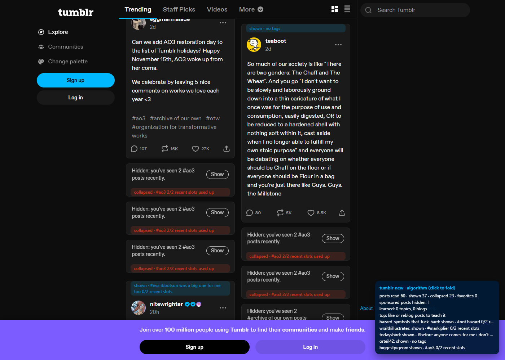

# tumblr-new

A browser extension that fixes the three things everyone complains about on Tumblr. No API key needed.

- **No ads.** [adblock-rs](https://www.npmjs.com/package/adblock-rs) compiles EasyList + AdGuard into static block rules and Tumblr cosmetic CSS at build time. Sponsored posts are also hidden by stable markers.
- **A feed that remembers.** Liking one black hole post no longer floods your dashboard. The CaliStream engine gives every topic a share of the feed proportional to your long-term interest, with a prior that stops one like from taking over. A topic you keep scrolling past cools down for the session. Old interests fade over months instead of being overwritten. Three real engagements in one session mean a genuine new obsession, so it follows that. Tags are grouped on-device (`#black holes` counts toward `#space`) from how tags appear together, with no ML model. Joke and commentary tags (`#i am screaming`) are ignored. A post only collapses if *all* its topics are full, the same blog can't take more than 2 of every 16 posts, repeat reblogs of a post you already saw collapse, and 1 slot in 10 goes to something new so you don't get stuck in a bubble. Nothing is deleted: every hidden post has a "Show anyway" button, and pressing it teaches the engine.
- **Never miss a mutual.** Tie strength is measured against how much a blog posts, so a quiet friend whose every post you like outranks a firehose you sometimes like. Mutuals (and pinned blogs) skip the topic limits and get highlighted, up to 3 per 16 posts. Their public RSS is checked every 30 min, and the toolbar badge counts posts you haven't seen.
- **See the algorithm think.** Every post gets a one-line reason ("collapsed · #ao3 2/2 recent slots used up") and a live panel shows what it read, hid and learned. Toggle it off in the popup.
- **No "Go Premium" nagging.** Optional, on by default.

All data stays on your device (`chrome.storage.local`). No Tumblr API key, no server, no tracking.

## Install

1. Download `tumblr-new.zip` from [Releases](../../releases/latest) and unzip it.
2. Chrome / Comet / Edge / Brave / Arc: open `chrome://extensions`, turn on **Developer mode**, click **Load unpacked**, pick the unzipped folder.
3. Firefox: `about:debugging` → This Firefox → **Load Temporary Add-on** → pick `manifest.json`.
4. Open your dashboard. Like and reblog as usual; it learns from that.

## Develop

1. `npm install` (builds adblock-rs, needs a Rust toolchain)
2. `npm run build` regenerates `extension/rules/ads.json` + `extension/cosmetic.css` (`-- --refresh` re-downloads lists)
3. Chrome / Comet / Edge: `chrome://extensions` → Developer mode → Load unpacked → `extension/`
   Firefox: `about:debugging` → Load Temporary Add-on → `extension/manifest.json`

`npm test` runs the feed algorithm tests. `CHROME=<chrome-for-testing> node scripts/try.mjs [url]` loads the extension in a real browser and prints what it did.

## Layout

- `extension/feed.js`: the CaliStream engine. Pure JS with no DOM, so it can be ported to a mobile app. Built from published work: calibrated recommendations (Steck 2018), confidence-aware calibration, xQuAD diversification, satiation (Kapoor et al. 2015), tie strength (Gilbert & Karahalios 2009), Thompson-style exploration (Chapelle & Li 2011).
- `extension/content.js`: reads posts off the dashboard, records likes/reblogs, collapses or highlights posts.
- `extension/background.js`: RSS catch-up for favorite blogs.
- `scripts/build-filters.mjs`: adblock-rs → DNR rules + CSS.
