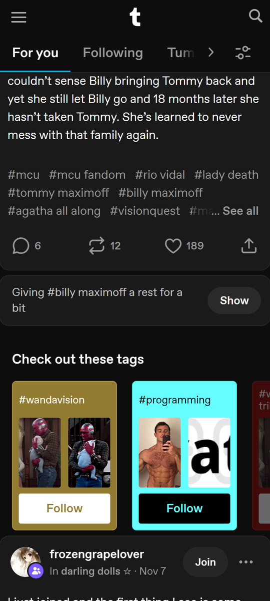
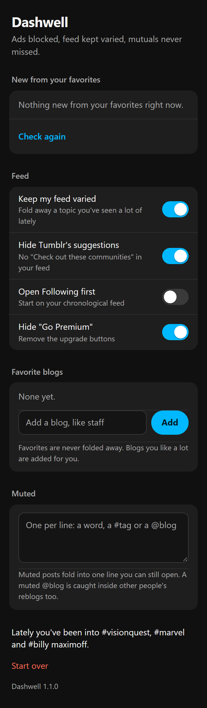

# Dashwell

Your Tumblr dashboard, done well. A browser extension and an Android app that fix what people complain about most, with no Tumblr API key and nothing leaving your device.

  
  

## What it fixes

- **No ads.** Ad networks blocked with EasyList + AdGuard rules (compiled by [adblock-rs](https://www.npmjs.com/package/adblock-rs)), sponsored posts and the sidebar ad hidden.
- **One like doesn't flood your feed.** Each topic gets room in proportion to your long-term interest, not your last tap. Seen a lot of one topic? The rest fold into one calm line with a Show button. `#black holes` counts toward `#space`, and joke tags like `#i am screaming` are ignored.
- **Never miss a mutual.** Blogs you always like are never folded away, and new posts from your favorites show up in Dashwell's settings.
- **Following stays chronological**, with flood control: one blog's 20-post reblog spree folds after 3. Optionally open Following first.
- **Mute words, #tags and @blogs.** A muted blog is caught inside other people's reblogs too.
- **No "Check out these communities", no "Go Premium", no "Rather use the app?" banners.**
- **Real tab titles** ("Following · Tumblr", "#art · Tumblr") so browser history stops collapsing every page into "Tumblr".
- **Repeat reblogs** of a post you already saw fold away.

## Install

**Android:** download `Dashwell.apk` from [Releases](../../releases/latest), open it, allow the install. Log in with email and password (Google and Apple block sign-in inside apps; use "Forgot password" with your Google email to set one). The app tells you when an update is out.

**Chrome, Comet, Edge, Brave, Arc:** download `Dashwell-extension.zip` from [Releases](../../releases/latest) and unzip it. Open `chrome://extensions`, turn on **Developer mode**, click **Load unpacked**, pick the folder. Dashwell's settings show when a new version is out.

**Firefox:** `about:debugging` → This Firefox → **Load Temporary Add-on** → `manifest.json`.

## How the feed works

`extension/feed.js` is the engine, plain JavaScript with no DOM, shared by the extension and the app. It is built from published recommender research: calibrated recommendations (Steck 2018) with a Dirichlet prior so one like can't take over, session satiation (Kapoor et al. 2015), tag grouping by co-occurrence (NPMI), xQuAD-style multi-topic rescue, tie strength normalized by posting rate (Gilbert & Karahalios 2009), and a 1-in-10 discovery slot. `npm test` runs its scenarios.

## Develop

- `npm install` (builds adblock-rs; needs a Rust toolchain), `npm run build` regenerates the ad rules and cosmetic CSS, `npm test` runs the engine tests.
- Android: `cd android && ./gradlew assembleRelease` (the app ships `extension/` as its assets, so both stay in sync).
- `CHROME=<chrome-for-testing> node scripts/try.mjs [url]` loads the extension in a real browser and reports what it did.
